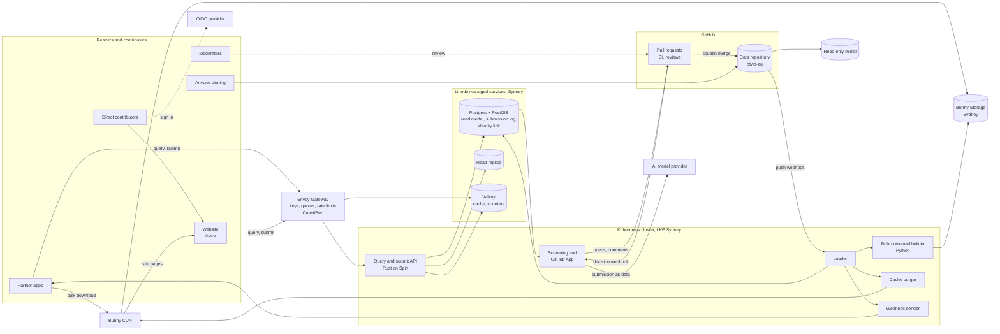

<!-- SPDX-License-Identifier: CC-BY-4.0 -->

# Architecture

This document describes how the OTWD platform works: the four paths data takes, the components and how they connect, the moderation pipeline, how the platform scales, and its environments. Domain terms are defined in [CONTEXT.md](../CONTEXT.md). The reasons behind each choice are in [the ADRs](adr/).

## The four paths

Live data lives in a public data repository on GitHub, one per supported country, starting with `opentouring/otwd-au` ([ADR 0046](adr/0046-live-data-in-a-public-git-repository-per-country.md)). Every record is a JSON file and every change is a commit on `main`. The platform on opentouring.org takes submissions in, and serves a read model built from the data repository out.

The **clone path** serves the whole dataset with its history to anyone, with no API key. A reader clones the data repository from GitHub, or from its read-only mirror on a second forge, and builds what they like under CC BY 4.0. The platform does no work for this path.

The **bulk download path** serves the whole dataset as files. A pipeline builds full and delta bulk downloads (GeoParquet and GeoJSON, one file set per record type, with point geometry for sites and road restrictions and line geometry for road segments and ferry services) from the read model, writes them to Bunny Storage in Sydney and publishes them through Bunny CDN. A partner app presents its API key to get a download link. This path carries most of the bytes and almost none of the compute.

The **query API path** answers questions such as "sites within 50 km of this point with drinking water and room for a 7 m caravan" and "road restrictions along this route that a 3.5 m high rig cannot pass". Route queries match records within a corridor either side of the route geometry the partner app sends, using PostGIS, and OTWD never stores the route. Requests pass through the gateway, which checks the API key, the quota and the rate limit, then reach stateless API instances that read from Postgres replicas through the managed database's connection pool, with hot responses cached in Valkey.

The **submit and moderate path** takes submissions from partner apps and direct contributors. The API appends each submission to the private submission log and returns at once. Screening runs the fixed checks that need private data and a screen for spam and personal information, and a submission that passes becomes a pull request on the data repository, opened by the GitHub App. CI, the AI review and routing report on the pull request, and a moderator's review is the moderation decision ([ADR 0047](adr/0047-moderation-on-github-through-pull-requests.md)). A merge is a change. The loader applies it to the read model, then rebuilds affected bulk downloads, purges cached pages and pushes webhooks to partner apps on paid tiers.

## Components

**Data repositories.** One public GitHub repository per supported country, created from the `otwd-template` repository. Records live at `<state>/<record-type>/<ulid>.json`, with records that cross a state border under `interstate/`. A file holds the record's repository form: the full form without the values OTWD computes on load. `otwd.json` pins the schema tag the data conforms to. Folder names and `otwd.json` are set by [ADR 0048](adr/0048-data-repository-layout-and-ci-file-licence.md). A ruleset on `main` allows only squash merges through the merge queue, after an approving review from the state's moderators team in CODEOWNERS. Each repository is mirrored read-only to a second forge.

**GitHub App.** Opens a pull request for each screened submission, in scheduled batches so a pull request's time does not reveal when a contributor submitted. It authors those commits itself, so nothing in git identifies the contributor. It posts the AI verdict, sets routing labels, relays moderators' questions to contributors and their answers back, opens appeal and revert pull requests, and merges automatic approvals once the moderation policy switches them on.

**Gateway.** Envoy Gateway, configured through the Kubernetes Gateway API, is the only way into the cluster. It resolves the API key to a tier, enforces quotas and rate limits (counters in Valkey) and passes the partner app's identity to the API. CrowdSec runs beside it and blocks abusive addresses.

**API.** The query and submit API is written in Rust and runs as WebAssembly on Spin, scheduled by SpinKube. Instances hold no state, so they start and stop with demand. Query endpoints read from replicas. Submit endpoints write only to the submission log. There is no endpoint that changes a site in place.

**Database.** Postgres with PostGIS holds the read model of every record type (point and line geometry), the submission log, moderation decisions, the identity link and trust scores. The read model can be rebuilt from the data repository at any time. It is Linode's managed Postgres with PostGIS in Sydney, outside the cluster ([ADR 0017](adr/0017-postgres-with-postgis.md)). CloudNativePG in the cluster is kept only as a fallback. Connections from the many short-lived API instances go through the managed service's built-in connection pool, and PgBouncer is added only if that pool proves not enough. Heavy reads go to replicas. Every instant is stored as `timestamptz` and sent in UTC, while opening hours and other local schedules are stored as local times with the record's IANA time zone ([ADR 0032](adr/0032-utc-for-instants-local-time-for-schedules.md)).

**Screening.** Rust services that read new submissions from the submission log, run the fixed checks that need private data (trust scores, rate limits), screen for spam and personal information, and request a verdict from the AI model provider. A submission that fails is rejected with a moderation decision and never reaches GitHub. One that passes goes to the GitHub App. Screening also records each moderation decision from GitHub's pull request webhook and sends `submissionDecided` to the partner app.

**Loader.** Keeps the commit SHA it last applied, and on each push webhook, and every 5 minutes as a backstop, applies the commits between that SHA and `main` to the read model in order. It assigns each change its sequence number, computes derived values and confidence, publishes merged photos from quarantine, and drives the bulk download builder, the cache purger and the webhook sender. Each of those is idempotent, because the loader can replay a commit after a restart. After a history rewrite the loader rebuilds the read model from an empty database.

**Pipelines.** Python jobs (GDAL, Shapely, GeoPandas) import seed sources as batch pull requests with seed-source provenance, one per seed source per refresh, and build bulk downloads after changes.

**Identity.** A self-hosted OIDC provider (Zitadel or Keycloak) signs in direct contributors. Moderators review on GitHub under their own accounts. Contributors who come through a partner app are known only by the pseudonymous ID the partner app sends. The identity link between contributors and their contributions stays in the database for moderation, trust scores and abuse handling, and the data repositories, published records, bulk downloads and the change feed never carry it ([ADR 0038](adr/0038-contributor-identity-in-published-data.md)). A contributor who opens a pull request from their own GitHub account chooses to be public.

**Website.** An Astro site that uses only the public API, with its own API key. Site pages at `/sites/<state>/<slug>-<id>` are rendered on demand and cached at the CDN with stale-while-revalidate, then purged when a change touches the site. The map is a MapLibre GL island on a free OSM-based basemap. The developer portal is Starlight, with API reference generated from the OpenAPI spec. Contribute and appeal pages are signed-in islands that call the API, never GitHub. Per-language routes will come later, with governed list labels in the reader's language and contributors' free text in the language it was written in.

**Cache.** Valkey, run as a Linode managed service outside the cluster ([ADR 0019](adr/0019-valkey-for-cache-and-rate-limits.md)), holds hot responses and the gateway's rate-limit counters.

**Storage and edge.** Bulk download files and photos are stored in Bunny Storage in Sydney, behind Bunny CDN, which serves them and caches website pages ([ADR 0021](adr/0021-bunny-cdn-and-crowdsec-instead-of-cloudflare.md)). The cache purger removes stale pages and download indexes when changes arrive. Photos never go into git. They reach Bunny Storage only through the API: a contributor's app uploads to an upload URL on the API host, and the API checks the file and strips EXIF location before writing it to a private quarantine area ([ADR 0029](adr/0029-object-storage-deferred-singapore-bucket-for-infrastructure-state-only.md)). The pull request links to a signed preview, and the loader publishes the photo when the pull request merges.

**Observability.** OpenTelemetry traces and metrics from every service, Prometheus and Grafana for metrics and dashboards, Loki for logs, and a Sentry-compatible error tracker. Every service logs in UTC.

## Moderation pipeline

Every submission follows the same stages, whoever sent it and whatever tier their API key is on. Where each stage runs is set by [ADR 0047](adr/0047-moderation-on-github-through-pull-requests.md).

1. **Append.** The API validates the request shape, records the contributor (pseudonymous ID and partner app, or signed-in direct contributor) and appends the submission to the private submission log. The contributor gets a submission ID to follow.
2. **Fixed checks.** Deterministic code checks the schema, that the location is on land and inside a supported country (for a line, that it follows a road, track or water crossing), that both terminals of a ferry service are sites whose site types include `ferry_terminal`, that a vertical clearance's or width limit's `lowest_m` is the lowest figure of any basis, and that towing permitted never comes from a seed source. It finds duplicate candidates of the same record type by distance and name similarity, flags price and capacity outliers, compares photo hashes against known images, strips embedded location data from photos and enforces per-contributor and per-key rate limits. It also works out whether the submission is on the always-human list: a creation kind, a closure, a merge, or any fact or facility the record type's schema marks as a safety fact (`x-otwd-safety-fact`). It sets the `accessibility_raised` flag on a submission that raises wheelchair access for any feature to yes, sets step-free access or Changing Places to true, or says no key is needed. Routing reads these results and never sets them. Checks that need private data run in screening, and checks that need only the data repository run again in CI on the pull request and in the merge queue. `schema/tools/validate.py` applies the same checks to the examples.
3. **AI review.** A small fast model reviews every submission and returns a structured verdict: category, confidence, reasons and evidence. Uncertain or high-risk submissions are escalated to a stronger model. The submission is passed to the model strictly as data, and the model has no tools that write anything. The review runs in screening, never in a GitHub Action, and the verdict is posted on the pull request.
4. **Screening.** A submission that fails the fixed checks or the screen for spam and personal information is rejected with a moderation decision and never reaches GitHub. One that passes becomes a pull request.
5. **Routing.** Fixed code, never the model, decides where the submission goes from its type, the fixed-check results, the verdict and the trust scores of the contributor and API key, and records it as labels on the pull request. Submissions on the always-human list (new records of every record type, closures, merges and any change to a safety fact), as the fixed checks found them, always go to a person, and a moderation decision by a routing rule on one fails validation. A submission flagged `accessibility_raised` goes to a person too, recorded in the decision's `routing.fixed_check_flags` as a reason of its own rather than as membership of the always-human list ([ADR 0033](adr/0033-structured-accessibility-on-sites-and-ferry-services.md)). At launch every submission goes to a person. Automatic approval of low-risk changes switches on only once enough human decisions exist to measure verdict accuracy against them.
6. **Decision.** A moderator in the state's team reviews the pull request: approves, rejects, amends and then approves, or asks for more information. Automatic approvals, once enabled, are made by the GitHub App and recorded the same way. Every moderation decision records who or what made it, the model version, the verdict and the reasons. The public parts go in trailers on the squash commit, and the full decision stays in the database.
7. **Apply.** An approved pull request is squash-merged through the merge queue, and the commit is the change. The loader applies it to the read model and gives it the next sequence number.
8. **Publish.** The loader drives the bulk download builder, the cache purger and the webhook sender.

The rules for each stage are published in [the moderation policy](policies/moderation.md), whose version every moderation decision records. Human decisions are kept as the evaluation set used to measure the AI review. Contributors can appeal a moderation decision, and an appeal is reviewed by a different moderator. Trust scores are recalculated from decision outcomes.

## Scaling

The platform starts at minimum size (a small cluster, one database plus a replica) and every part scales out without a redesign. API instances are stateless and scale with request volume, down to zero when idle. Read load scales by adding replicas and by caching in Valkey and at the CDN. The managed database and Valkey are resized through OpenTofu like the cluster. Clones and bulk downloads move most bulk reading off the cluster entirely. A surge of submissions waits in the submission log and in the GitHub App's batches, so it delays moderation instead of failing requests. The submission log is append-only, so it partitions by time when it grows. A country's data repository splits into one per state or territory when it passes 1 GB or CI on a pull request takes longer than 10 minutes.

## Environments

**Preview** is the environment running now. It is the production stack at minimum size, with seeded government data for Victoria, the first state ([ADR 0024](adr/0024-one-state-first.md)), and only the maintainer's submissions. Outside contributions are switched off at the gateway. FuelOracle, as founding partner, sends contribute-back submissions to a separate **staging** environment only, which mirrors preview, writes to the private `otwd-au-staging` data repository, and is where partner integrations are tested.

**Production** opens once a host agreement is signed and the contributor terms are in force. It is the same code and infrastructure definitions as preview, sized up, with outside contributions switched on.

Database backups, restores and restore tests follow [the disaster recovery runbook](operations/disaster-recovery.md) ([ADR 0041](adr/0041-disaster-recovery-and-backups.md)).

OpenTofu state is kept, encrypted, in one Linode Object Storage bucket in Singapore, the only use of Linode Object Storage ([ADR 0029](adr/0029-object-storage-deferred-singapore-bucket-for-infrastructure-state-only.md)). All environments are defined with OpenTofu and deployed by Argo CD from this repository, so a new environment, or a move to the host's own accounts, is a matter of applying the same code with different settings.
