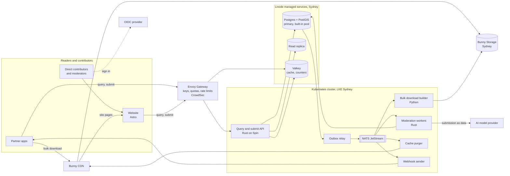

<!-- SPDX-License-Identifier: CC-BY-4.0 -->

# Architecture

This document describes how the OTWD platform works: the three paths data takes, the components and how they connect, the moderation pipeline, how the platform scales, and its environments. Domain terms are defined in [CONTEXT.md](../CONTEXT.md). The reasons behind each choice are in [the ADRs](adr/).

## The three paths

OTWD serves three kinds of traffic, each with its own path through the platform.

The **bulk download path** serves the whole dataset as files. A pipeline builds full and delta bulk downloads (GeoParquet and GeoJSON, one file set per record type, with point geometry for sites and road restrictions and line geometry for road segments and ferry services) from live data, writes them to Bunny Storage in Sydney and publishes them through Bunny CDN. A partner app presents its API key to get a download link. This path carries most of the bytes and almost none of the compute.

The **query API path** answers questions such as "sites within 50 km of this point with drinking water and room for a 7 m caravan" and "road restrictions along this route that a 3.5 m high rig cannot pass". Route queries match records within a corridor either side of the route geometry the partner app sends, using PostGIS, and OTWD never stores the route. Requests pass through the gateway, which checks the API key, the quota and the rate limit, then reach stateless API instances that read from Postgres replicas through the managed database's connection pool, with hot responses cached in Valkey.

The **submit and moderate path** takes submissions from partner apps and direct contributors. The API appends each submission to the submission log and returns at once. Moderation workers run fixed checks and the AI review, routing sends the submission to a queue, and a moderation decision either applies a change to live data or records why not. Each change then rebuilds affected bulk downloads, purges cached pages and pushes webhooks to partner apps on paid tiers.

## Components

**Gateway.** Envoy Gateway, configured through the Kubernetes Gateway API, is the only way into the cluster. It resolves the API key to a tier, enforces quotas and rate limits (counters in Valkey) and passes the partner app's identity to the API. CrowdSec runs beside it and blocks abusive addresses.

**API.** The query and submit API is written in Rust and runs as WebAssembly on Spin, scheduled by SpinKube. Instances hold no state, so they start and stop with demand. Query endpoints read from replicas. Submit endpoints write only to the submission log and the outbox, in one transaction. There is no endpoint that changes a site in place.

**Database.** Postgres with PostGIS holds live data for every record type (point and line geometry), the submission log, moderation decisions, trust scores and the outbox. It is Linode's managed Postgres with PostGIS in Sydney, outside the cluster ([ADR 0017](adr/0017-postgres-with-postgis.md)). CloudNativePG in the cluster is kept only as a fallback. Connections from the many short-lived API instances go through the managed service's built-in connection pool, and PgBouncer is added only if that pool proves not enough. Heavy reads go to replicas. Every instant is stored as `timestamptz` and sent in UTC, while opening hours and other local schedules are stored as local times with the record's IANA time zone ([ADR 0032](adr/0032-utc-for-instants-local-time-for-schedules.md)).

**Event bus.** NATS JetStream carries events between components. Services never publish directly: they write an outbox row in the same transaction as the data, and the outbox relay publishes it. Consumers are idempotent because an event can arrive more than once.

**Moderation workers.** Rust services that consume submission events, run the fixed checks, request a verdict from the AI model provider, apply routing rules, and apply approved changes to live data. They are the only writers of live data.

**Pipelines.** Python jobs (GDAL, Shapely, GeoPandas) import seed sources as submissions with seed-source provenance, and build bulk downloads after changes. Seed imports go through the same submission log and moderation pipeline as contributions from people.

**Identity.** A self-hosted OIDC provider (Zitadel or Keycloak) signs in direct contributors and moderators. Contributors who come through a partner app are known only by the pseudonymous ID the partner app sends.

**Website.** An Astro site that uses only the public API, with its own API key. Site pages at `/sites/<state>/<slug>-<id>` are rendered on demand and cached at the CDN with stale-while-revalidate, then purged when a change touches the site. The map is a MapLibre GL island on a free OSM-based basemap. The developer portal is Starlight, with API reference generated from the OpenAPI spec. Contribute and moderate pages are signed-in islands that call the API. Per-language routes will come later, with governed list labels in the reader's language and contributors' free text in the language it was written in.

**Cache.** Valkey, run as a Linode managed service outside the cluster ([ADR 0019](adr/0019-valkey-for-cache-and-rate-limits.md)), holds hot responses and the gateway's rate-limit counters.

**Storage and edge.** Bulk download files and photos are stored in Bunny Storage in Sydney, behind Bunny CDN, which serves them and caches website pages ([ADR 0021](adr/0021-bunny-cdn-and-crowdsec-instead-of-cloudflare.md)). The cache purger removes stale pages and download indexes when changes arrive. Photos reach Bunny Storage only through the API: a contributor's app uploads to an upload URL on the API host, and the API checks the file and strips EXIF location before writing it to storage ([ADR 0029](adr/0029-object-storage-deferred-singapore-bucket-for-infrastructure-state-only.md)).

**Observability.** OpenTelemetry traces and metrics from every service, Prometheus and Grafana for metrics and dashboards, Loki for logs, and a Sentry-compatible error tracker. Every service logs in UTC.

## Moderation pipeline

Every submission follows the same stages, whoever sent it and whatever tier their API key is on.

1. **Append.** The API validates the request shape, records the contributor (pseudonymous ID and partner app, or signed-in direct contributor) and appends the submission to the submission log. The contributor gets a submission ID to follow.
2. **Fixed checks.** Deterministic code checks the schema, that the location is on land and inside a supported country (for a line, that it follows a road, track or water crossing), that both terminals of a ferry service are sites whose site types include `ferry_terminal`, that a vertical clearance's or width limit's `lowest_m` is the lowest figure of any basis, and that towing permitted never comes from a seed source. It finds duplicate candidates of the same record type by distance and name similarity, flags price and capacity outliers, compares photo hashes against known images, strips embedded location data from photos and enforces per-contributor and per-key rate limits. It also works out whether the submission is on the always-human list: a creation kind, a closure, a merge, or any fact or facility the record type's schema marks as a safety fact (`x-otwd-safety-fact`). Routing reads that result and never sets it. `schema/tools/validate.py` applies the same checks to the examples.
3. **AI review.** A small fast model reviews every submission and returns a structured verdict: category, confidence, reasons and evidence. Uncertain or high-risk submissions are escalated to a stronger model. The submission is passed to the model strictly as data, and the model has no tools that write anything.
4. **Routing.** Fixed code, never the model, decides where the submission goes from its type, the fixed-check results, the verdict and the trust scores of the contributor and API key. Submissions on the always-human list (new records of every record type, closures, merges and any change to a safety fact), as the fixed checks found them, always go to a person, and a moderation decision by a routing rule on one fails validation. At launch every submission goes to a person. Automatic approval of low-risk changes switches on only once enough human decisions exist to measure verdict accuracy against them.
5. **Decision.** A moderator approves, rejects, amends and then approves, or asks for more information. Automatic approvals, once enabled, are recorded the same way. Every moderation decision records who or what made it, the model version, the verdict and the reasons.
6. **Apply.** An approved submission becomes a change: live data is updated, the change gets the next sequence number, and a change event goes to the outbox in the same transaction.
7. **Publish.** Change events drive the bulk download builder, the cache purger and the webhook sender.

Human decisions are kept as the evaluation set used to measure the AI review. Contributors can appeal a moderation decision, and an appeal is reviewed by a different moderator. Trust scores are recalculated from decision outcomes.

## Scaling

The platform starts at minimum size (a small cluster, one database plus a replica) and every part scales out without a redesign. API instances are stateless and scale with request volume, down to zero when idle. Read load scales by adding replicas and by caching in Valkey and at the CDN. The managed database and Valkey are resized through OpenTofu like the cluster. Bulk downloads move most bulk reading off the cluster entirely. Moderation workers scale with the depth of the submission queue, and JetStream buffers bursts so a surge of submissions delays moderation instead of failing requests. The submission log is append-only, so it partitions by time when it grows.

## Environments

**Preview** is the environment running now. It is the production stack at minimum size, with seeded government data for Victoria, the first state ([ADR 0024](adr/0024-one-state-first.md)), and only the maintainer's submissions. Outside contributions are switched off at the gateway. FuelOracle, as founding partner, sends contribute-back submissions to a separate **staging** environment only, which mirrors preview and is where partner integrations are tested.

**Production** opens once a host agreement is signed and the contributor terms are in force. It is the same code and infrastructure definitions as preview, sized up, with outside contributions switched on.

OpenTofu state is kept, encrypted, in one Linode Object Storage bucket in Singapore, the only use of Linode Object Storage ([ADR 0029](adr/0029-object-storage-deferred-singapore-bucket-for-infrastructure-state-only.md)). All environments are defined with OpenTofu and deployed by Argo CD from this repository, so a new environment, or a move to the host's own accounts, is a matter of applying the same code with different settings.
